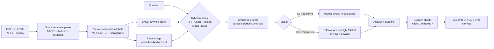
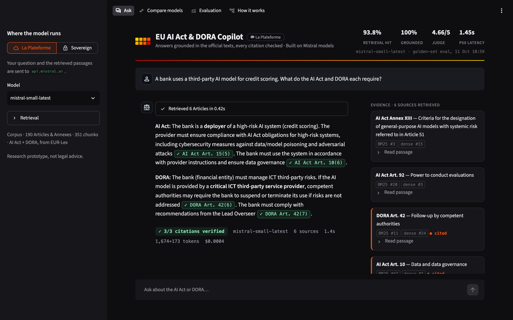
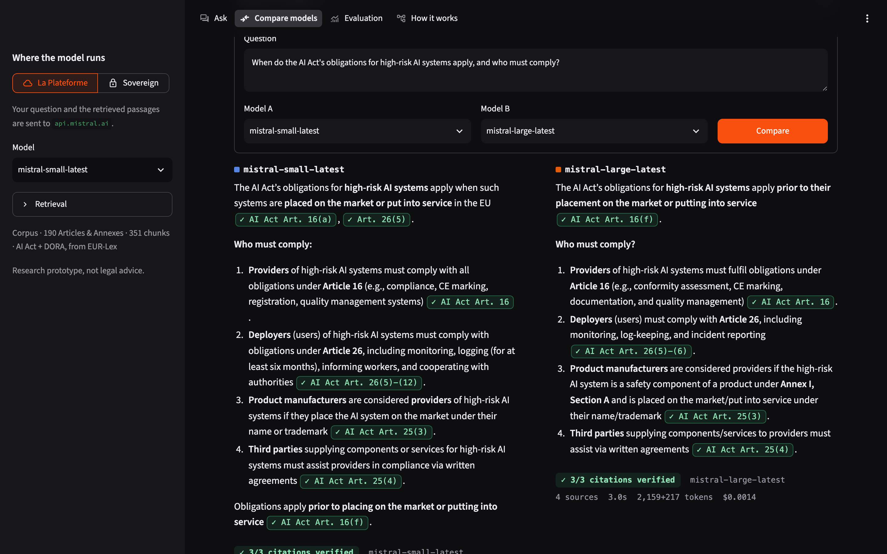
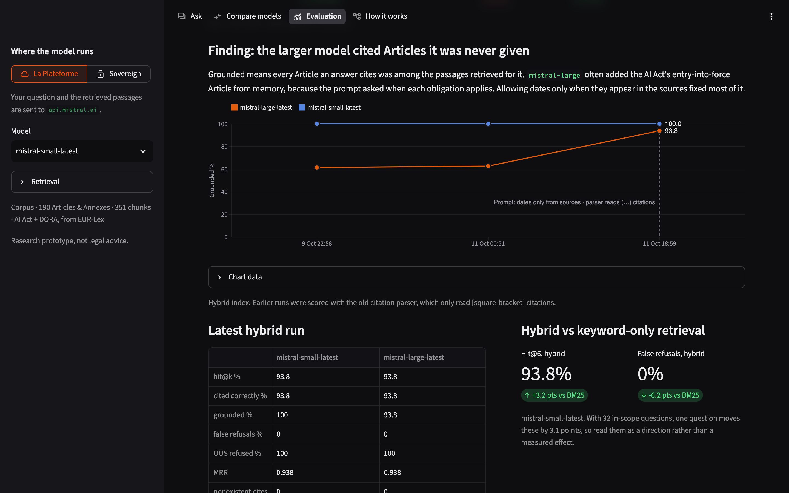

# EU AI Act & DORA Copilot


A retrieval-augmented assistant that answers questions about the **EU AI Act** (Regulation (EU) 2024/1689) and **DORA** (Regulation (EU) 2022/2554), with a citation to the exact Article or Annex for every claim. It runs on Mistral models, either through **La Plateforme** or **fully on your own machine** with open-weight models ("sovereign mode"). It comes with an **evaluation harness** that measures retrieval quality, citation accuracy, groundedness and refusals across models.

> Built for European financial-services teams who need to understand their AI and ICT-resilience obligations, and who shouldn't have to send regulatory questions to infrastructure outside their control to get answers.

**Results at a glance** (35-question golden set, full table and method under [Evaluation](#evaluation)): 93.8% of expected Articles retrieved; `mistral-small` matches `mistral-large` on judged quality (4.66 vs 4.78) at roughly twice the speed and a third of the cost; every citation is checked against the retrieved text, with invented Articles counted separately; and a 7B open-weight model running fully on an 8 GB Mac mini judges 4.69/5 with zero invented citations — sovereignty works on ordinary hardware, at ~30× the latency.

## Why

European banks and insurers now sit under two major regulations at once. The AI Act governs how they build and use AI, and it treats credit scoring and life and health insurance pricing as high-risk. DORA governs their ICT risk, incident reporting and third-party providers. Compliance, risk and architecture teams ask questions that cut across both, and they need answers they can verify.

This project shows three things:

1. **Grounded, checkable answers.** Retrieval follows the structure of the law. Every answer cites Articles, and the app flags any citation that wasn't actually retrieved.
2. **Deployment choice.** The same pipeline runs on the hosted Mistral API or on a local open-weight model with nothing leaving the machine. That is the deployment model regulated European institutions increasingly need.
3. **Measured quality.** A golden set of 35 questions and a metrics harness compare models and modes, so choosing a model rests on evidence rather than vibes. Running a small model where it's good enough is also cheaper and lower-carbon.

## Architecture



| Component | File | Notes |
|---|---|---|
| Fetching | `regcopilot/fetch.py` | Gets the official texts from the EU Publications Office's Cellar repository, with fallbacks. Validates each candidate by parsing it, and records provenance (URL, SHA-256, date). If the EU is unreachable, `ingest` falls back to the committed corpus snapshot (`corpus/`). |
| Ingestion | `regcopilot/ingest.py`, `parse.py` | Parses on text headings ("Article 27", "ANNEX III", "CHAPTER V"), not CSS classes, so it survives markup changes. Drops signatures and footnotes. |
| Chunking | `parse.py` | Chunks never cross Article boundaries. Long Articles split on numbered paragraphs, and each chunk carries its citation label and paragraph numbers. |
| Retrieval | `index.py`, `bm25.py` | BM25 + dense embeddings fused with Reciprocal Rank Fusion. Named references ("DORA Article 28") are looked up directly. |
| Generation | `rag.py`, `llm.py` | Strict grounding prompt with a fixed refusal sentence. One client interface for `mistral`, `ollama` and an offline `mock`. Plain HTTP, no SDK lock-in. |
| Evaluation | `eval/` | 32 in-scope and 3 out-of-scope questions with expected Articles and reference answers. Optional LLM-as-judge. |
| UI | `app.py`, `ui/` | Streamlit app with four pages: Ask (streamed answers with every citation checked inline), Compare models, Evaluation and How it works. See [The app](#the-app). |

## Quick start (macOS / Linux)

```bash
python3 -m venv .venv && source .venv/bin/activate
pip install -r requirements.txt
cp .env.example .env            # then add your MISTRAL_API_KEY

python tests/test_pipeline.py   # offline tests, no key needed

python -m regcopilot ingest     # fetches + parses both regulations into data/chunks.json
python eval/verify_golden.py    # checks the eval set against the ingested text
python -m regcopilot index --embed mistral

python -m regcopilot ask "Does an insurer pricing life cover with AI need a fundamental rights impact assessment?"
streamlit run app.py
```

**How the texts are fetched.** EUR-Lex's website blocks scripts with a bot check, so `regcopilot/fetch.py` gets the official texts from the EU Publications Office's **Cellar** repository, the machine-facing store behind EUR-Lex. It tries, in order: the exact English XHTML file on Cellar, Cellar content negotiation (CELEX number plus "English XHTML"), the EUR-Lex page itself, and finally any copy saved from a browser into `data/raw/` under any filename. A candidate is accepted only if it parses into the expected number of Articles, so a bot-check page can never be indexed by mistake. Each download is cached and recorded in `data/raw/manifest.json` with its URL, the route used, a SHA-256 hash and the date. If every route fails, `ingest` falls back to a snapshot of the chunked corpus committed with the repository (`corpus/`, ~650 KB, reused under the Commission's reuse policy), so a fresh clone builds a working corpus even when the EU's servers are unreachable — the manifest records such sources as `committed-snapshot` with the original fetch's provenance. To use the snapshot deliberately — for example to reproduce the published eval numbers exactly against the same corpus, whatever Cellar serves that day — run `python -m regcopilot ingest --snapshot`.

```bash
python -m regcopilot fetch --refresh -v   # show every route tried and which one worked
```

## Quick start (Windows)

The pipeline is pure Python with no platform-specific code, so the same steps run on Windows (PowerShell); only the venv activation differs. CI runs the offline tests on Linux, so Windows isn't separately CI-tested:

```powershell
python -m venv .venv
.venv\Scripts\Activate.ps1              # if scripts are blocked: Set-ExecutionPolicy -Scope Process RemoteSigned
pip install -r requirements.txt
Copy-Item .env.example .env             # then add your MISTRAL_API_KEY

python tests\test_pipeline.py           # offline tests, no key needed

python -m regcopilot ingest             # fetches + parses both regulations into data\chunks.json
python eval\verify_golden.py            # checks the eval set against the ingested text
python -m regcopilot index --embed mistral

python -m regcopilot ask "Does an insurer pricing life cover with AI need a fundamental rights impact assessment?"
streamlit run app.py
```

## The app

`streamlit run app.py` opens four pages.

**Ask.** Answers stream in, and every citation in them becomes a pill once the answer is complete. A green pill means the cited Article was among the passages the model was given; an amber one means it wasn't; a red, struck-through one means the Article doesn't exist. Hovering a pill shows the Article's title and opening text. The evidence column lists each retrieved Article with its BM25 and dense ranks, marks the ones the answer cited, and shows the passage on demand.



**Compare models.** One question, retrieved once, answered by two models side by side, so any difference comes from the model alone: what it cites, whether those citations were in its sources, latency and cost.



**Evaluation.** The golden-set results for each model and index, how they changed across runs, and every question's answer with its citations checked, its expected Articles and the judge's reasoning.



**How it works.** The pipeline, the design decisions, the corpus with its provenance hashes, and a retrieval inspector that shows how BM25 and dense ranks fuse for any query.

In sovereign mode the app runs entirely on your machine. It loads no web fonts or CDN assets, the favicon is drawn locally, and Streamlit's usage statistics are switched off in `.streamlit/config.toml`. The hybrid index built with `mistral-embed` isn't offered in sovereign mode, because using it would send every query to the API.

### Sovereign mode (everything local)

```bash
brew install ollama && ollama serve          # or see ollama.com for Linux and Windows installers
ollama pull mistral-nemo                     # open-weight Mistral model (needs ~16 GB)
ollama pull nomic-embed-text                 # local embedding model
python -m regcopilot index --embed ollama
python -m regcopilot ask "What must ICT third-party contracts include under DORA?" --backend ollama
```

On machines with 8 GB of unified memory, use the 7B model and a smaller context window instead (`ollama pull mistral:7b`, then `OLLAMA_NUM_CTX=4096` — see below):

```bash
OLLAMA_NUM_CTX=4096 python -m regcopilot ask "What must ICT third-party contracts include under DORA?" --backend ollama --model mistral:7b
```

`OLLAMA_NUM_CTX` sets Ollama's context budget (default 8192). The KV cache grows with it — roughly a quarter of a GB per 1k tokens for a 7B model — and when weights plus cache exceed the machine's unified memory, layers spill off the GPU and inference slows dramatically: on the 8 GB Mac mini above, the same question took 166s at 8192 context and 42s at 4096, purely from the memory fit. The ~3k tokens a grounded prompt actually uses fit comfortably in 4096. Because Ollama truncates prompts beyond the window *silently* — which would drop grounding rules and sources without any error — the client estimates the prompt size and refuses to send one that doesn't fit, telling you to raise `OLLAMA_NUM_CTX` or retrieve fewer sources.

In the UI, pick **Sovereign mode**. Questions, documents and embeddings then never leave the machine.

## Evaluation

```bash
# Hosted: small vs large, judged by mistral-large
python eval/run_eval.py --backend mistral --models mistral-small-latest,mistral-large-latest --judge mistral-large-latest

# Sovereign: local model and local embeddings (as measured above on an 8 GB Mac mini)
OLLAMA_NUM_CTX=4096 python eval/run_eval.py --backend ollama --models mistral:7b --embed ollama --judge mistral-large-latest

# Retrieval ablation: keyword-only vs hybrid
python eval/run_eval.py --backend mistral --embed none
```

| Metric | Meaning |
|---|---|
| hit@k | An expected Article/Annex was among the retrieved sources |
| MRR | How high the first correct source ranked |
| cited correctly | The answer cites at least one expected Article/Annex |
| grounded | Every citation refers to a source that was actually retrieved |
| nonexistent cites | Citations to Articles/Annexes that don't exist in the regulation at all |
| false refusals / OOS refused | Declines answerable questions (bad) vs declines out-of-scope ones (good) |
| judge (1–5) | LLM-as-judge score against a hand-written reference answer |
| latency, tokens, cost | Cost appears once you fill in `prices.json` (see `prices.example.json`) |

### Results

Measured 9–11 October 2026 against the 35-question golden set (32 in-scope, 3 out-of-scope), k=6, judge = `mistral-large-latest` scoring 1–5 against hand-written reference answers. Costs are actual token counts at La Plateforme list prices (Mistral Small $0.15/$0.60, Mistral Large $0.50/$1.50 per million input/output tokens). The sovereign run was measured on a 2020 Mac mini (Apple M1, 8 GB): `mistral:7b` (q4_0) and `nomic-embed-text` via Ollama, context 4096, answers generated entirely on the machine — only the judge ran on the API.

> **Hybrid rows are a fresh run (11 October 2026) with two fixes in place.** The citation parser now reads citations anywhere in the answer ("(DORA Art. 30(2))", not only `[square brackets]`), and system-prompt Rule 4 asks for dates only when the sources state them. The BM25-only rows predate the fixes; their `cited correctly` figures are re-scored offline from the saved answers with the fixed parser (retrieval metrics are unchanged by a parser fix). This run also added the `nonexistent cites` check: both models scored 0.

| model | backend | index | hit@6 % | MRR | cited correctly % | grounded % | nonexistent cites | false refusals % | OOS refused % | judge (1–5) | p50 latency s | cost ($) | per query ($) |
 |---|---|---|---|---|---|---|---|---|---|---|---|---|---|
 | mistral-small-latest | mistral | mistral (hybrid) | 93.8 | 0.938 | 93.8 | 100.0 | 0 | 0.0 | 100.0 | 4.66 | 1.45 | 0.0147 | 0.0004 |
 | mistral-large-latest | mistral | mistral (hybrid) | 93.8 | 0.938 | 93.8 | 93.8 | 0 | 0.0 | 100.0 | 4.78 | 2.71 | 0.0465 | 0.0013 |
 | mistral-small-latest | mistral | none (BM25, re-scored) | 90.6 | 0.839 | 90.6 | 92.9 | – | 6.2 | 100.0 | 4.50 | 1.26 | 0.015 | 0.0004 |
 | mistral-large-latest | mistral | none (BM25, re-scored) | 90.6 | 0.839 | 96.9 | 53.3 | – | 3.1 | 100.0 | 4.72 | 2.98 | 0.048 | 0.0014 |
 | mistral:7b (sovereign) | ollama | ollama (hybrid, local) | 93.8 | 0.875 | 90.6 | 96.9 | 0 | 0.0 | 66.7 | 4.69 | 43.13 | n/a | – |

**Reading the table.**

- **Hybrid retrieval helps, but on a small sample.** Hit@6 rises from 90.6% to 93.8% and false refusals fall from 6.2% to zero with both models. With 32 in-scope questions that is one question, so treat it as a direction rather than a measured effect. Every hit also ranks first (MRR equals hit rate), which suggests the golden set is phrased close to the Article text and doesn't yet test ranking.
- **Small matches large on quality at a fraction of the cost.** Judge scores are 4.66 vs 4.78, with the caveat that `mistral-large-latest` is also the judge; `mistral-small-latest` runs at roughly twice the speed (p50 1.45s vs 2.71s) and about a third of the cost. With retrieval doing the heavy lifting, the smaller model is sufficient — cheaper, faster and lower-carbon.
- **Groundedness is the interesting failure mode.** In the earlier runs the large model padded answers with never-retrieved entry-into-force Articles (AI Act Art. 113, DORA Art. 64) and once cited DORA Art. 99, which does not exist — 62.5% grounded. The original prompt asked the model to say "from when" each obligation applies, which invited dates the retrieval rarely supplies; Rule 4 now allows dates only when they appear in the sources. In the fresh run the large model is 93.8% grounded and invents nothing: its two ungrounded citations (AI Act Art. 3 in aia-20, DORA Art. 16 in dora-05) are real Articles cited from memory rather than from the retrieved context. The small model remains 100% grounded. For a regulated-domain assistant, a plausible citation with no retrieved evidence behind it is worse than a refusal, which is why the harness checks grounding per answer — and now separately counts citations to Articles that don't exist. Bigger models know more, and that is precisely the problem.

- **Sovereign mode works, on ordinary hardware.** A 7B open-weight Mistral model on an 8 GB Mac mini — the low end of consumer machines — scores 93.8% hit@6 and judges at 4.69/5 (marginally above hosted `mistral-small`'s 4.66), inventing no Articles and falsely refusing nothing. Retrieval is *not* identical to the hosted run, though: sovereign mode embeds with `nomic-embed-text` rather than `mistral-embed`, and the retrieved sources differ on 30 of the 35 questions — the two retrieval misses coincide (aia-13, aia-16), so hit@6 is the same, but MRR is lower (0.875 vs 0.938). Its one out-of-scope failure is instructive: asked about a GDPR fine, it refuses in the required words *and then answers anyway from memory* ("4% of global annual turnover or EUR 20 million"). The refusal detector now catches declines followed by figures from memory, and accepts paraphrased declines — scored that way, the sovereign run refuses 2 of 3 out-of-scope questions (66.7%), missing the one where it leaked. Refusing is not enough on its own; the pipeline checks what comes after the refusal. The price of sovereignty is latency: p50 43s vs 1.45s hosted, roughly 30× slower.
**Failure analysis.** 30 of the 32 in-scope questions were answered correctly
across both hosted models in the final run. The two persistent failures are both retrieval
misses, not generation failures:

- **aia-13** ("Does a customer service chatbot have to tell people they are talking to an AI?")
  — the expected source, Article 50(1) on transparency for AI systems interacting with
  natural persons, was not retrieved. Both models answered from Article 26(11) (high-risk
  transparency), the closest retrieved alternative, and were marked down for it.
- **aia-16** ("What are the maximum fines for using a prohibited AI practice?") — the
  expected source, Article 99(3) (up to €35M or 7% of worldwide turnover), was not retrieved.
  Both models cited the retrieved fines articles (100 and 101), which cover Union
  institutions and general-purpose AI models respectively. The small model's answer states
  €1,500,000 — the Union-institutions cap from Article 100(2) — and the judge scored it
  2/5: fully grounded in the retrieved context, confidently wrong. A grounded answer built
  on incomplete retrieval is the most dangerous failure mode here, worse than a refusal,
  and the citation check alone cannot catch it because every citation was retrieved.

In both cases every citation was grounded in retrieved context — the models used exactly
the evidence they were given. Both questions are phrased in language that differs from the
article text ("customer service chatbot" vs "AI systems intended to interact directly with
natural persons"), so neither lexical nor embedding ranking surfaces the right unit within
the top 6, and neither query names a unit that the explicit lookup could boost. This is
the motivation for the planned re-ranking step (scoring the top ~20 candidates with a small
model before generation). For aia-16 that should work: BM25 alone ranks Article 99 as the
fifth unit, just below the cut. For aia-13 it may not: Article 50 is not in BM25's top 50
chunks at all, so it depends on the dense ranking or on query rewriting.

Persistent failure categories in the fresh run: retrieval misses 2, false refusals 0,
invented citations 0. The harness attributes each failure to its layer: these two are
retrieval problems; the large model's earlier ungrounded date citations were a prompt
problem, fixed by Rule 4.

Token counts for the sovereign run are not comparable with the hosted rows (Ollama counts its own tokenizer's tokens) and its cost is n/a by design: the machine is the meter. Sovereign latency was measured with the project and corpus on the machine's internal disk; the same question over a network-mounted copy of the corpus differed by a few seconds at most, because per-question time is inference-bound, not I/O-bound.

## Design decisions

- **Structure over sliding windows.** Lawyers cite Articles, so retrieval units are Articles. That makes citations checkable and lets the eval score retrieval against a known right answer.
- **Hybrid retrieval.** Regulatory users type exact terms of art ("register of information", "TLPT"). BM25 catches those, embeddings catch paraphrases ("can my boss use AI to read my mood?"), and RRF combines them without tuning weights.
- **Refusal is a feature.** A fixed refusal sentence makes "I don't know" measurable. The out-of-scope questions check that the model doesn't answer GDPR questions from AI Act text. The detector accepts paraphrased declines, and rejects a decline followed by figures from memory — refusing in words and then answering anyway is a failure, not a refusal.
- **Citation verification.** The answer is checked after generation: any citation that wasn't in the retrieved context is flagged as ungrounded.
- **Backend-agnostic, minimal dependencies.** Plain HTTP to La Plateforme and Ollama keeps the code easy to audit, which matters in regulated environments.

## Limitations

- Research prototype, **not legal advice**. Answers are only as good as the retrieved text and should be checked against the cited Articles.
- The corpus is the original published text of each regulation. Later amendments, delegated or implementing acts, regulatory technical standards and guidance (for example from the ESAs or the AI Office) are not included. Application dates may change through later legislation, so check EUR-Lex for the consolidated version.
- Reference answers in `eval/golden.jsonl` were written by hand from the regulations. `verify_golden.py` checks that each expected Article exists and contains a key phrase, but the references deserve expert review.
- Recitals are excluded by default (`--recitals` adds them). They help interpretation but can crowd out operative Articles in retrieval.

## Roadmap

- Multilingual: ingest the French and German texts, ask in one language and cite in another
- Add ESA/EBA/EIOPA guidelines and DORA RTS/ITS as a second tier of sources
- Re-ranking step and query rewriting for multi-hop questions ("an insurer using a third-party LLM for pricing")
- Fine-tune a small open-weight model on citation formatting and refusal behaviour, and compare it with prompting alone

## Sources

- [Regulation (EU) 2024/1689 (AI Act), EUR-Lex](https://eur-lex.europa.eu/eli/reg/2024/1689/oj)
- [Regulation (EU) 2022/2554 (DORA), EUR-Lex](https://eur-lex.europa.eu/eli/reg/2022/2554/oj)

© European Union, https://eur-lex.europa.eu. EU legal texts may be reused under the Commission's reuse policy.
